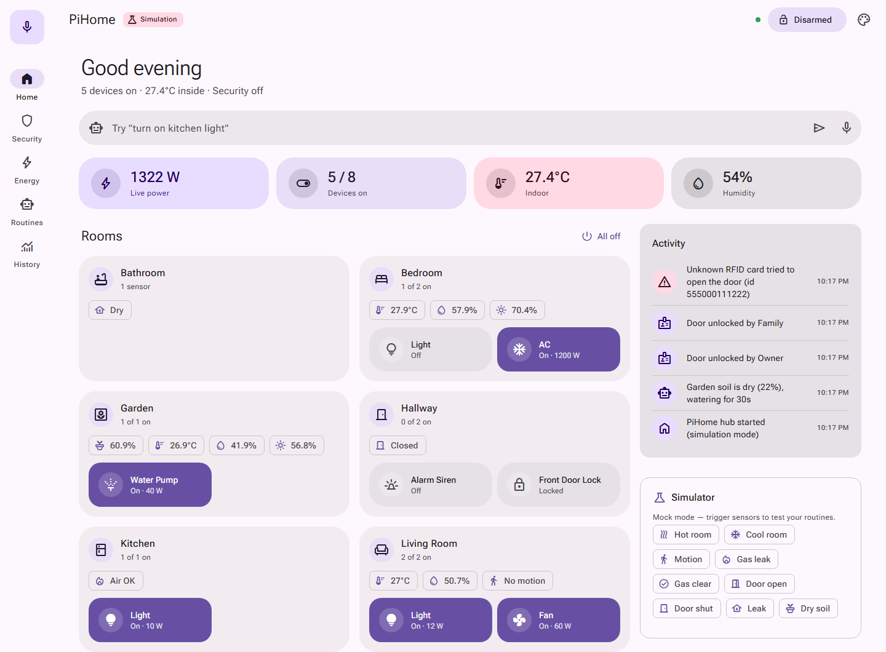
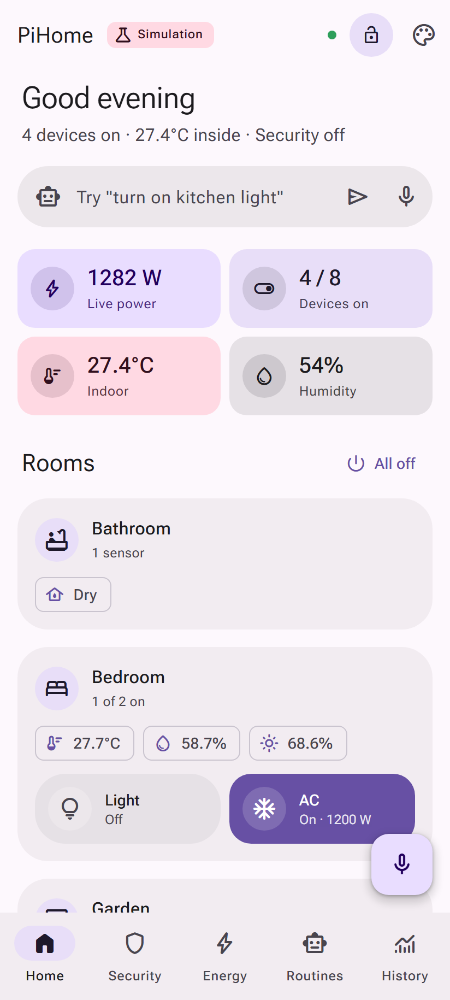
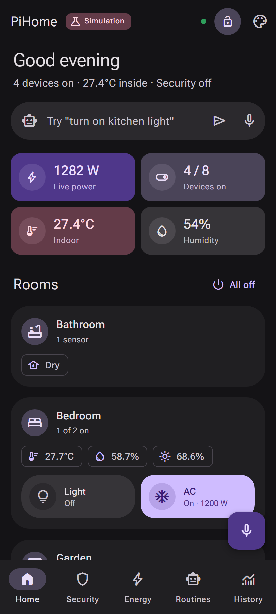
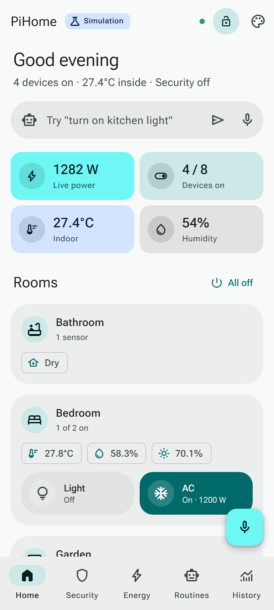
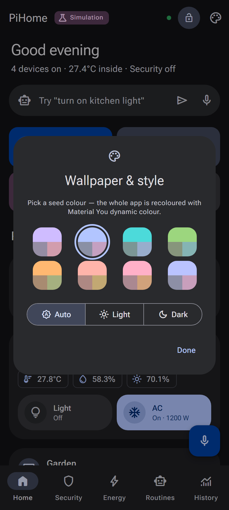
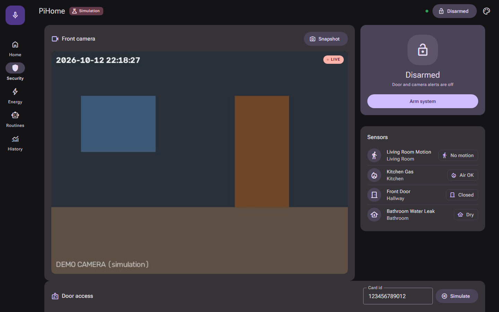
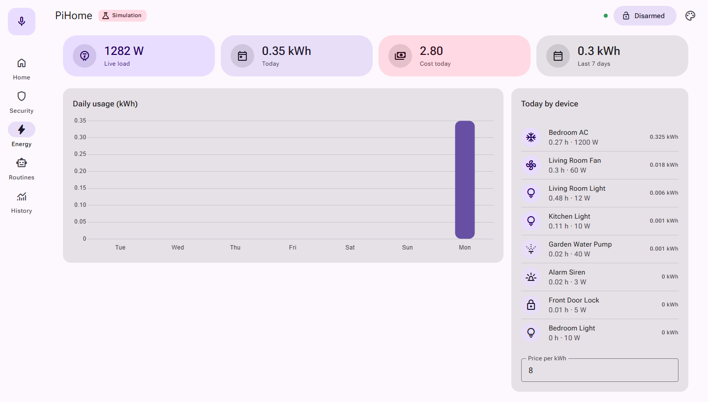
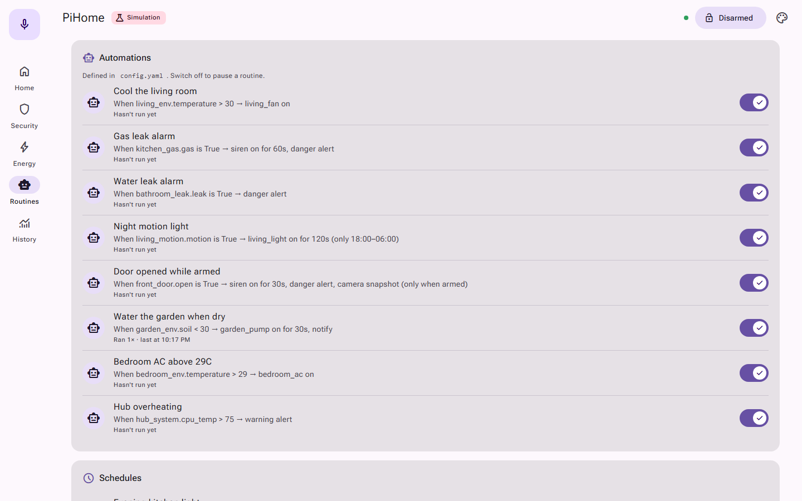
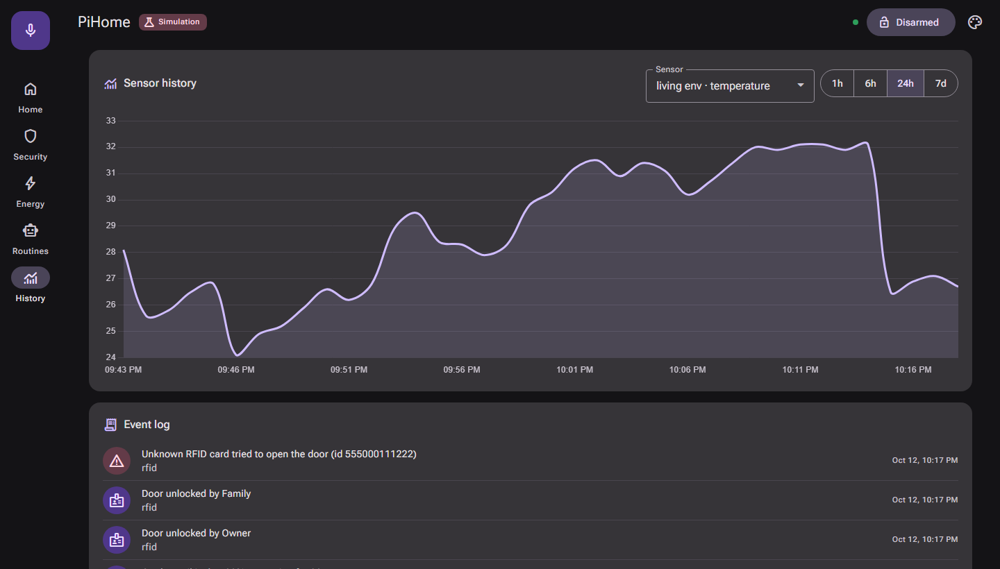
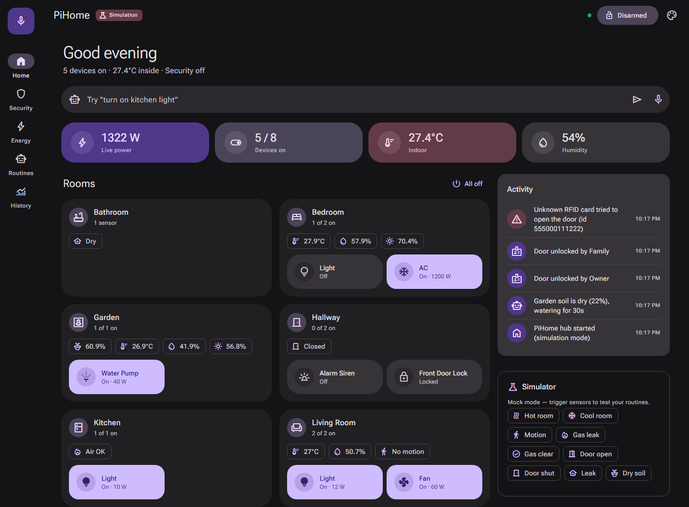

# 🏠 PiHome: Raspberry Pi 4 smart home hub

A complete, modular smart home system. The Raspberry Pi 4 is the brain. It controls lights and appliances,
watches over the house with a camera and sensors, waters the garden, tracks energy use, and takes commands from a
web dashboard, Telegram, or your voice. Wireless **ESP32 room nodes** let it cover the whole house.

   

<picture>
  <source media="(prefers-color-scheme: dark)" srcset="docs/screenshots/home-dark.png">
  
</picture>

<p align="center">
  
  
  
  
</p>
<p align="center"><sub>Android-style Material You dashboard on a phone: light, dark, dynamic colour, and the theme picker</sub></p>

## ✨ Features

| Module | What it does |
|---|---|
| 💡 **Lights and appliances** | Relays on the Pi and on ESP32 nodes, with toggles, timers, and schedules |
| 🤖 **Automation engine** | "If X then Y" rules in YAML: thresholds, hysteresis, time windows, cooldowns, armed-only |
| 🛡️ **Security** | Arm/disarm, door sensors, motion, siren, alert photos |
| 📷 **Smart camera** | Live stream, motion detection, snapshots, optional face recognition |
| 🔥 **Safety** | Gas/smoke and water-leak alarms with instant alerts |
| 🌱 **Garden** | Soil moisture → automatic watering pump |
| 🌡️ **Climate** | Temperature and humidity in every room; fan/AC automation |
| ⚡ **Energy monitor** | Live load, daily kWh, 7-day chart, cost estimate per device |
| 🔑 **RFID door** | RC522 card access with an access log; auto-disarms for known cards |
| 🎙️ **Voice control** | Offline (Vosk): "home, turn on the bedroom light" |
| 📱 **Dashboard** | Material 3 / Material You web app (Android-style): dynamic colour themes, light/dark, quick-settings tiles, navigation rail / bottom bar, voice FAB, installable on your phone |
| ✈️ **Telegram bot** | Alerts with photos and remote control from anywhere: `/status`, `/on`, `/arm`, `/photo` |
| 🧪 **Simulation mode** | Runs on any PC with fake sensors, so you can develop without hardware |

## 📸 Screenshots

> Captured from simulation mode (`python main.py --mock`), so you can see the same thing on your PC without any hardware.

### 🛡️ Security: live camera, arm/disarm, sensors, RFID access log


### ⚡ Energy: live load, daily kWh, cost and per-device usage


### 🤖 Routines: every automation from `config.yaml`, with on/off switches


### 📈 History: sensor charts and the event log


<details>
<summary><b>Home screen, light and dark (desktop)</b></summary>



</details>

**UI highlights:** Material 3 navigation rail (desktop) and bottom navigation bar (phone) · quick-settings device
tiles · dynamic colour from 8 seed colours · auto, light and dark modes · voice FAB · snackbars · M3 switches, chips and
segmented buttons · installable as a phone app ("Add to Home screen").

## 📁 Project structure

```
rapaberry 5.0/
├── README.md
├── docs/
│   ├── WIRING.md            ← parts list, Pi + ESP32 pinouts, safety
│   ├── ARCHITECTURE.md      ← design, MQTT topics, REST API, how to extend
│   └── screenshots/         ← images used in this README
├── hub/                     ← runs on the Raspberry Pi
│   ├── main.py              ← entry point
│   ├── config.yaml          ← devices, sensors, automations, schedules
│   ├── requirements.txt     ← core deps (PC + Pi)
│   ├── requirements-pi.txt  ← GPIO / RFID / voice extras
│   ├── .env.example         ← secrets template
│   ├── app/
│   │   ├── core.py          ← Home state + event bus
│   │   ├── config.py        ← config loader / validator
│   │   ├── hardware.py      ← real + simulated GPIO
│   │   ├── devices.py       ← relays (GPIO / MQTT)
│   │   ├── sensors.py       ← DHT22, PIR, gas, door, leak, ESP32, system
│   │   ├── automation.py    ← rule engine + schedules
│   │   ├── mqtt_client.py   ← ESP32 bridge
│   │   ├── database.py      ← SQLite history / energy / logs
│   │   ├── notifier.py      ← Telegram bot
│   │   ├── camera.py        ← stream, motion, faces
│   │   ├── rfid.py          ← RC522 door access
│   │   ├── voice.py         ← offline voice commands
│   │   └── api.py           ← REST + WebSocket
│   ├── static/              ← Material 3 dashboard (index.html, style.css, app.js, theme.js)
│   └── tests/               ← pytest suite
├── firmware/
│   └── esp32_room_node/     ← Arduino sketch + config.h for each room
└── scripts/
    ├── install.sh           ← one-command Pi setup (+ Mosquitto + systemd)
    ├── pihome.service       ← auto-start on boot
    ├── backup.sh            ← config + database backups
    └── run_dev.bat          ← run on Windows in simulation mode
```

## 🚀 Quick start

### A) Try it on your PC (no hardware needed)

```bash
cd hub
pip install -r requirements.txt
python main.py --mock
```
Open **http://localhost:8000**. Use the **🧪 Simulator** panel to trigger gas, motion, a door opening, and so on, and watch the
automations react. On Windows you can also double-click `scripts/run_dev.bat`.

### B) Install on the Raspberry Pi 4

1. Flash **Raspberry Pi OS (64-bit, Bookworm)** with Raspberry Pi Imager. Enable SSH and Wi-Fi in the imager.
2. Copy this folder to the Pi (e.g. `~/pihome`) using `scp`, a USB stick, or git.
3. Run the installer:
   ```bash
   cd ~/pihome
   bash scripts/install.sh
   sudo reboot
   ```
4. Open `http://<pi-ip>:8000` from any phone or PC on your Wi-Fi.
5. Wire your hardware ([docs/WIRING.md](docs/WIRING.md)) and edit `hub/config.yaml` to match, then run:
   ```bash
   sudo systemctl restart pihome
   journalctl -u pihome -f
   ```

### C) Add ESP32 room nodes
Flash `firmware/esp32_room_node` (see [WIRING.md](docs/WIRING.md#esp32-room-node-firmwareesp32_room_node)), set `NODE_ID`,
and add matching `devices` / `sensors` entries with `driver: mqtt` / `type: mqtt` and `node: <NODE_ID>`.

### D) Telegram alerts (optional)
1. Message **@BotFather** → `/newbot` → copy the token.
2. Message your new bot, then open `https://api.telegram.org/bot<TOKEN>/getUpdates` to find your `chat.id`.
3. Put both in `hub/.env` (copy it from `.env.example`) and set `telegram.enabled: true` in `config.yaml`.

### E) Voice control (optional)
Download `vosk-model-small-en-us` from https://alphacephei.com/vosk/models, unzip it to `hub/data/`, plug in a USB
mic, and set `voice.enabled: true`.

## 🤖 Writing automations

```yaml
automations:
  - name: Night motion light
    when: { sensor: living_motion.motion, equals: true }
    only_between: ["18:00", "06:00"]
    then:
      - { device: living_light, action: on, for: 120 }   # auto-off after 2 min

  - name: Cool the living room
    when: { sensor: living_env.temperature, above: 30, hysteresis: 1 }
    then:      [ { device: living_fan, action: on } ]
    otherwise: [ { device: living_fan, action: off } ]  # off again below 29 °C
```
Actions: `device`, `notify`, `alert` (+ `level`), `snapshot`, `arm`. See all the examples in `hub/config.yaml`.

## 🧪 Tests

```bash
cd hub
python -m pytest -q
```

## 🗺️ Build roadmap (suggested order)

1. **Week 1:** Pi setup, one relay and a DHT22, dashboard running
2. **Week 2:** PIR, door, gas, and leak sensors, plus automations
3. **Week 3:** Mosquitto and the first ESP32 node (bedroom)
4. **Week 4:** camera, Telegram alerts, arm/disarm
5. **Week 5:** RFID door lock, garden node with pump
6. **Week 6:** voice control, energy tuning, enclosures, demo video

## ⚠️ Safety
Relays that switch mains voltage are dangerous. Prototype with low-voltage loads, use enclosures and fuses, and have
an electrician do the mains wiring. The gas and smoke alarm here is a hobby project. It does **not** replace certified
smoke or CO detectors.

## 💡 Ideas to extend
Home Assistant integration through MQTT discovery · PZEM-004T real energy metering · IR blaster for the TV and AC ·
curtain motor · weather-based watering · Grafana dashboards · presence detection by phone Wi-Fi.
